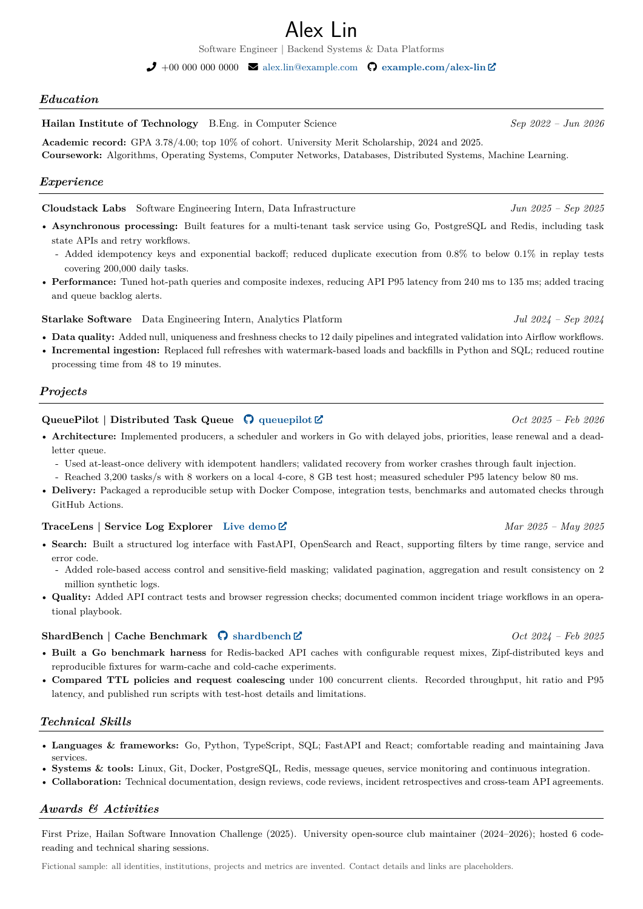
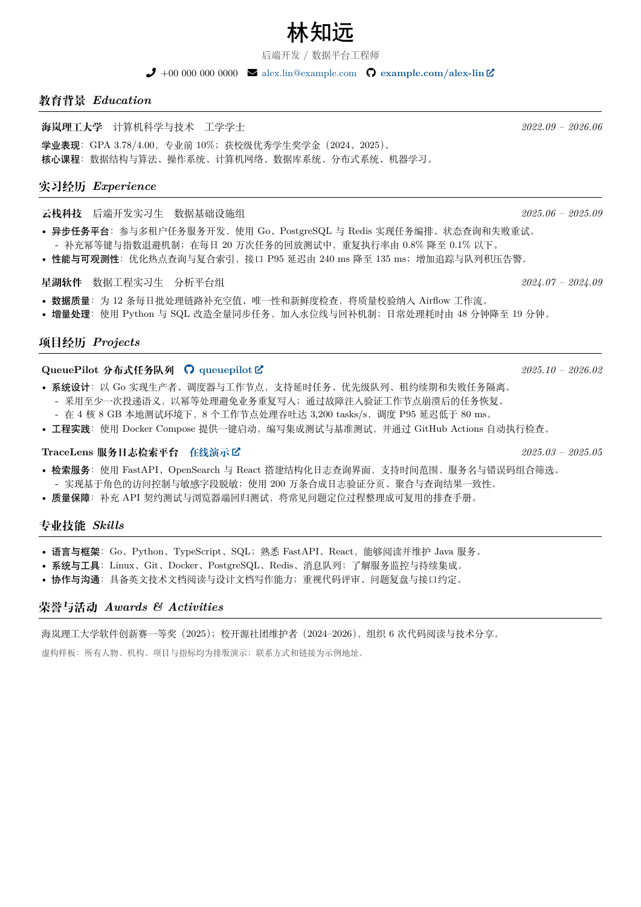

# Verso

A compact XeLaTeX resume template for tech careers, with matching English and Chinese samples.

English | [简体中文](README.zh-CN.md)

## Preview

| English | Chinese |
| :---: | :---: |
| [](resume-en.pdf) | [](resume-zh.pdf) |
| [Download PDF](resume-en.pdf) | [Download PDF](resume-zh.pdf) |

## Features

- Compact, single-page A4 layout with clear typographic hierarchy.
- Latin Modern English text, Fandol Chinese fonts, bold headings and italic dates.
- Blue hyperlinks with external-link icons and optional GitHub icons.
- Two list levels: bullet points and indented hyphens, with aligned wrapped text.
- Shared styling, bundled fonts and editable accent colors.

All sample identities, institutions, projects and achievements are **fictional**. Contact details and URLs use placeholder values and `example.com`.

## Get started

Install **TeX Live** or **MacTeX** with XeLaTeX, then run:

```sh
sh build.sh
```

This builds `resume-en.pdf` and `resume-zh.pdf`. Update your name and contact details in `resume-en.tex` or `resume-zh.tex`, then edit the corresponding `content-en.tex` or `content-zh.tex`.

**Overleaf:** upload the source files and `fonts/`, select **XeLaTeX**, and choose `resume-en.tex` or `resume-zh.tex` as the main document. The template uses standard packages: `xeCJK`, `fontspec`, `fontawesome5`, `hyperref`, `graphicx`, `geometry` and `xcolor`. Shell escape is not required.

## Customize

```latex
\ResumeSection{\textit{Projects}}
\ResumeEntry{\textbf{Project name}}{Oct 2025 -- Feb 2026}
\ResumeItem{Summarize the work and its outcome.}
\ResumeSubItem{Add implementation details or evaluation conditions.}
\ResumeLink{https://example.com/demo}{Live demo}
\ProjectLink{https://example.com/code/project}{project}
```

For bilingual headings, use `\ResumeSection{项目经历}{Projects}`. The header takes three arguments: `\ResumeHeader{Name}{Role}{Contact details}`; keep `{}` for unused fields.

`\ResumeText` creates an unbulleted paragraph. Use `\CompactItems` inside a group for tighter list spacing, and `\ProjectGap` / `\SectionGap` to separate blocks.

The default sizes are 9 pt for body text, 9.5 pt for entry titles and dates, and 11 pt for section headings. Set `accent` in the main document to add color to the name, headings and rules; try `244A73` for dark blue or `156B72` for teal. Edit `resume-style.sty` for link colors, spacing and indents.

## License

Template code, documentation and fictional sample content are released under the [MIT License](LICENSE). Bundled fonts retain their own licenses: Fandol uses GPL with the Font Exception, and Latin Modern uses the GUST Font License. See [licenses/](licenses/). Font Awesome is supplied by the TeX distribution's `fontawesome5` package under its original licenses.
