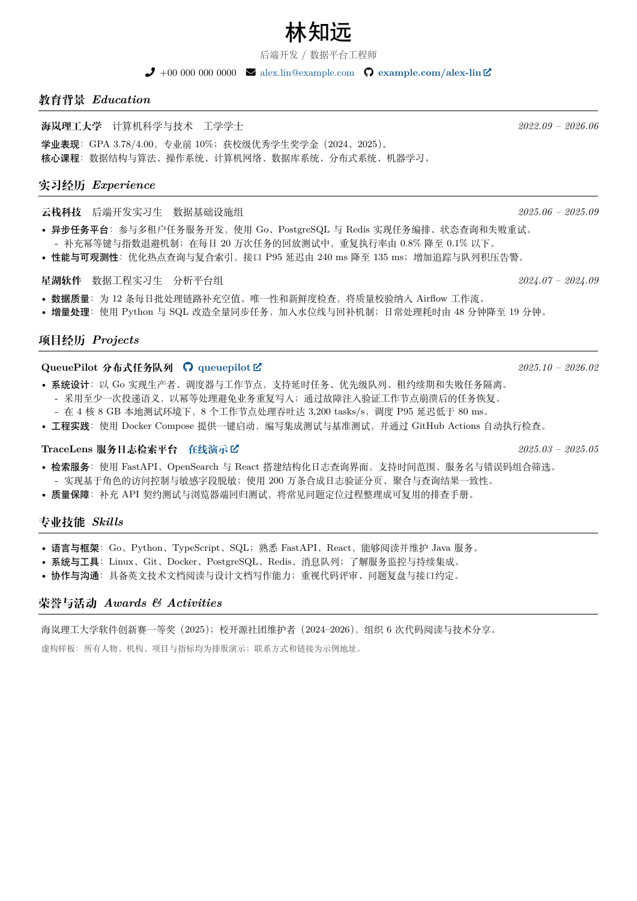
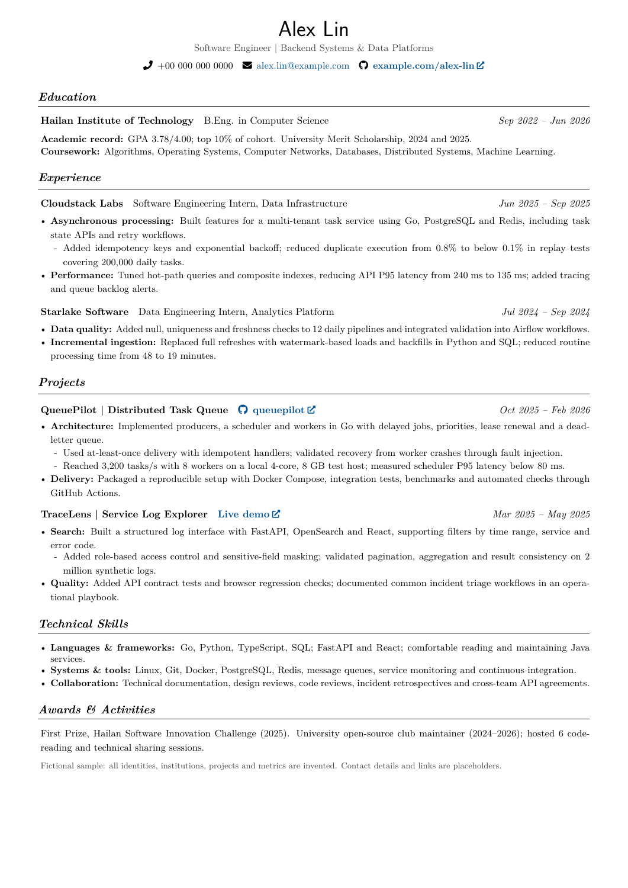

# Verso

简约、紧凑的中英文 XeLaTeX 简历模板。

[English](README.md) | 简体中文

## Preview · 效果预览

| 中文样板 | English sample |
| :---: | :---: |
| [](resume-zh.pdf) | [](resume-en.pdf) |
| [下载 PDF](resume-zh.pdf) | [Download PDF](resume-en.pdf) |

A4 单页布局，支持中英文栏目、关键词加粗、斜体日期、深蓝超链接和外链图标。保留一级圆点与二级横杠，提供紧凑的技能列表。英文采用 Latin Modern，中文采用 Fandol；字体随源码提供。

**所有样板信息均为虚构**，仅用于展示排版。邮箱与链接使用 `example.com`，请替换为自己的真实信息。All sample identities, institutions and achievements are fictional; contact details and links are placeholders.

## Quick start · 使用方法

安装包含 **XeLaTeX** 的 TeX Live / MacTeX，然后执行：

```sh
sh build.sh
```

生成 `resume-zh.pdf` 与 `resume-en.pdf`。修改 `resume-zh.tex` / `resume-en.tex` 中的姓名和联系方式，修改 `content-zh.tex` / `content-en.tex` 中的经历。

**Overleaf:** 上传源码与 `fonts/`，选择 XeLaTeX 编译器，并将主文件设为 `resume-zh.tex` 或 `resume-en.tex`。依赖常见的 `xeCJK`、`fontspec`、`fontawesome5`、`hyperref`、`graphicx`、`geometry`、`xcolor` 包，无需 shell escape。

```latex
\ResumeSection{项目经历}{Projects}
\ResumeEntry{\textbf{项目名称}}{2025.10 -- 2026.02}
\ResumeItem{一级圆点：主要工作与成果。}
\ResumeSubItem{二级横杠：方法、指标和测试条件。}
\ResumeLink{https://example.com/demo}{在线演示}
\ProjectLink{https://example.com/code/project}{project}
```

`\ResumeHeader{姓名}{求职方向}{联系方式}` 需要三个参数，不用的字段保留 `{}`。英文栏目可写为 `\ResumeSection{\textit{Projects}}`。`\ResumeText` 是无符号段落，`\CompactItems` 在分组内使用可压缩行距。

默认正文 9 pt、内部标题 9.5 pt、栏目标题 11 pt。修改入口文件中的 `accent` 可为姓名、栏目与横线设置高亮色，如 `244A73`（深蓝）或 `156B72`（墨绿）。日期、缩进和链接颜色在 `resume-style.sty` 中调整。

## License

模板代码、文档及虚构示例内容采用 [MIT License](LICENSE)。字体按各自许可证分发：Fandol 使用 GPL + Font Exception，Latin Modern 使用 GUST Font License，详见 [licenses/](licenses/)。Font Awesome 通过 TeX 发行版的 `fontawesome5` 包提供，遵循其原许可证。
